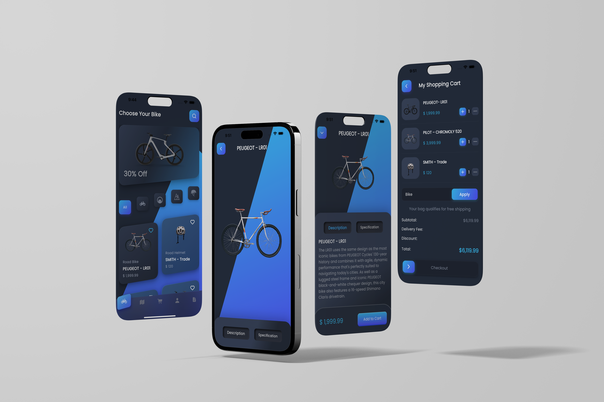

# ✨ Beautiful Flutter UI Showcase

A curated collection of modern, visually stunning, and high-performance Flutter mobile application user interfaces translated into production-quality code.

 

[🚴 Bike Store App](#-1-bike-store-mobile-app) • [💜 Purplee Weather App](#-2-purplee-weather-mobile-app) • [🛠️ Tech Stack](#️-tech-stack) • [👤 Author](#-author)

---

## 📱 Featured Projects

---

### 🚴 1. Bike Store Mobile App

A high-performance mobile application designed for cycling enthusiasts and athletes. Built with a sleek dark neumorphic aesthetic, glowing electric gradients, and fluid micro-interactions for a premium shopping and product exploration experience.

  

#### 🌟 Key Highlights
- **Neumorphic & Neon Aesthetics:** Deep dark-mode surfaces with vibrant electric gradient accents.
- **Product Discovery & Showcase:** Intuitive bike catalog browsing, specification cards, and interactive detail views.
- **Fluid Micro-interactions:** Smooth screen transitions and ergonomic navigation for mobile screens.
- **Source Code:** [🔗 Nidhal-Khazene/Bike-Store-Mobile-App](https://github.com/Nidhal-Khazene/Bike-Store-Mobile-App)

---

### 💜 2. Purplee Weather Mobile App

An atmospheric, minimalist weather forecast application inspired by modern Figma UI concepts. Delivers accurate weather metrics wrapped in soft purple gradients, clean typography, and elegant cards.

  

#### 🌟 Key Highlights
- **Atmospheric Visuals:** Aesthetic purple gradient themes adapting seamlessly to weather conditions.
- **Detailed Forecasts:** Real-time temperatures, hourly predictions, and comprehensive weekly forecasts.
- **Clean Figma-to-Code Implementation:** Pixel-perfect Flutter components following modern UI/UX design standards.
- **Source Code:** [🔗 Nidhal-Khazene/Purplee-Weather-Mobile-App](https://github.com/Nidhal-Khazene/Purplee-Weather-Mobile-App)

---

## 🛠️ Tech Stack

- **Framework:** [Flutter](https://flutter.dev/) (Cross-platform UI toolkit)
- **Language:** [Dart](https://dart.dev/)
- **Design Inspiration:** Modern Figma UI Kits & Neumorphic Design Systems
- **Target Platforms:** iOS & Android

---

## 👤 Author

**Nidhal Khazene**
- GitHub: [@Nidhal-Khazene](https://github.com/Nidhal-Khazene)

---

⭐ Star this repository if you find these Flutter UI designs inspiring!

